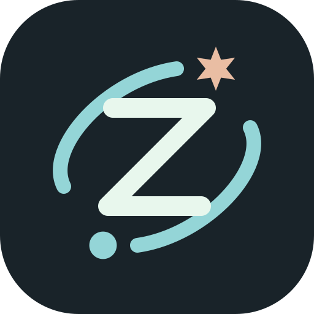

# zemiCC



**A little space. A big idea.**

一个安静、清爽的 Claude Agent SDK 桌面工作区。打开项目，输入自己的 API key，开始创造。

zemiCC is an independent desktop interface for the official Claude Agent SDK. It is not an official Anthropic application.

## 使用

Windows 10/11 x64 用户请从 [GitHub Releases](https://github.com/wanheng20031114/zemiCC/releases/latest) 下载：

- **安装版** `zemiCC-Setup-版本-x64.exe`：安装后使用桌面或开始菜单的 zemiCC，可右键任务栏图标固定。
- **免安装版** `zemiCC-版本-win-x64.zip`：解压到固定目录，双击 `zemiCC.exe`；不能只移动其中一个 EXE。

应用已内置桌面与 Claude Agent 运行时，无需另外安装 Node.js、npm 或全局 Claude Code。项目自己的编译器、Git 等开发工具仍需安装；Windows shell 工具建议安装 [Git for Windows](https://gitforwindows.org/)。

当前安装包未签名，Windows 可能显示未知发布者提示。Release 附有 `SHA256SUMS.txt`，可用 PowerShell 的 `Get-FileHash 文件名 -Algorithm SHA256` 核对下载内容。

1. 选择项目文件夹。
2. 点击左下角的连接按钮，在应用内输入自己的 Anthropic API key。
3. 描述任务。默认「智能自动」模式下，普通文件读写与源码搜索直接执行，命令由 SDK 自动审核。

输入框右下角可切换「智能自动」与「逐次确认」。选择会保存，应用于当前对话及新对话；执行中的任务需先结束或停止。SDK 根据完整命令及任务上下文判断风险，zemiCC 不再仅因命令包含 `../`、删除关键词或后台标记就强制弹窗。需要人工授权的请求会显示确认卡片与原因；凭据相关命令仍保留额外确认。敏感文件与项目外文件工具访问保持受限，Agent 的问题仍由你回答。

命令审核使用官方 SDK 的 [`auto` 权限模式](https://code.claude.com/docs/en/permission-modes#eliminate-permission-prompts-with-auto-mode)。如账户、模型或服务暂不支持，会显示降级提示并对命令请求确认。自动审核模型可能产生额外 API 费用，界面的费用估算不包含所有审核调用。

右上角 `− / 100% / +` 可缩放整个界面（80%–180%）。也支持 `Ctrl + +`、`Ctrl + =`、`Ctrl + −` 和 `Ctrl + 0` 复位；macOS 使用 Command。

## 已实现

- 真实 Claude Agent SDK 工具循环、流式回复、停止生成、多轮对话。
- Opus 5.5 / Haiku 5.5 模型选择（可用性和额度由你的 API 账户决定）。
- 自动 / 逐次确认权限模式，高风险操作说明，支持 Agent 的选择题与自由回答。
- 项目文件树、文本预览、Git 状态和差异预览。
- 本地会话历史，累计用量和费用估算。
- 独立 Windows 安装包、应用图标和任务栏固定；自适应界面、键盘发送、减少动画偏好。

## 密钥与数据

**zemiCC 不保存 API key。** 密钥只通过密码输入框进入本机后端内存，以及执行任务所需的 SDK 子进程环境；退出进程后需要重新输入。不会写入 `.env`、配置、浏览器存储或会话文件，也不会提交到仓库。SDK 仅直连 `https://api.anthropic.com`；不支持转发站，不伪装官方客户端。

项目路径及脱敏后的会话保存在 `%APPDATA%\zemiCC\workspace\workspace.json`，更新应用时保留；开发模式使用仓库内已被 Git 忽略的 `.zemicc/workspace.json`。SDK 原始会话持久化已关闭。进程运行时，多轮对话共享同一 SDK 上下文；应用重启、停止或更换 key 后，继续会话会将最近 60,000 字符的用户/助手记录作为上下文交给新的 SDK 会话，因此旧工具状态和更早的内容可能不完整。

权限审核**不是操作系统沙箱**。自动审核通过或由你批准的命令使用当前用户的系统权限，可以访问磁盘、进程环境和网络。只对信任的项目执行任务；审核并不保证识别所有危险行为。不要把密钥放进聊天或项目文件。详见 [SECURITY.md](SECURITY.md)。

## 开发与验证

开发需要 Node.js 22.17+。源码启动方式：

```sh
npm ci
npm test
npm run build
npm run desktop
```

`启动 zemiCC.vbs` 仅用于源码开发，不应固定到任务栏。可选浏览器模式：`npm start`，打开 `http://127.0.0.1:4317`；关闭页面不会关闭服务，退出服务后才会释放密钥。

`npm run dev` 通过 tsx 运行后端（前端改动后需重新构建）。服务默认只绑定 `127.0.0.1:4317`，可用 `ZEMICC_PORT` 和 `ZEMICC_DATA_DIR` 修改端口与本地数据目录。桌面模式使用 4317。

在 Windows x64 上运行 `npm run dist:win` 可构建安装包、ZIP 与校验文件，输出到已被 Git 忽略的 `release/`。`npm run verify:package` 检查应用文件、运行时完整性及用户数据排除。发布版本时，先更新 `package.json` / lockfile 的版本及 `docs/releases/v版本.md`，再推送同版本的 `v*` Git tag；Windows Release 工作流将测试、构建、实际启动程序，再上传 GitHub Release。二进制通过 Releases 分发，不提交进源码历史。

React + TypeScript + Vite · Express · Electron · Claude Agent SDK

zemiCC 源码采用 MIT License；捆绑组件保留各自许可，见 [THIRD_PARTY_NOTICES.md](THIRD_PARTY_NOTICES.md)。API 使用产生的费用及适用政策由你的 API 提供方决定。
